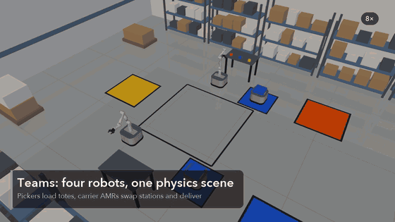

# anybot

**Drop in any robot, put it in any place, tell it what to do in plain English.**

anybot imports a robot model it has never seen (MuJoCo XML or URDF), works out what kind of robot it is and
how it moves, and exposes it to LLM agents through the [Model Context Protocol](https://modelcontextprotocol.io).
You ask Claude (or any MCP client) *"bring the mug from the kitchen counter to the sofa"* and watch it happen
live in a browser, with real rigid-body physics in [MuJoCo](https://mujoco.org).



Runs on a laptop: developed on a MacBook Air M1 with 8 GB of RAM, no GPU server.

## What it does

- **Any robot, no configuration.** A robot is classified from its kinematics alone: arm, dual arm, AMR,
  mobile manipulator, quadruped, humanoid. anybot then picks the skills that apply. Arms get IK, grasping
  (parallel grippers, multi-finger hands, suction) and pick-and-place. Wheeled bases drive. Quadrupeds trot.
  The Unitree G1 humanoid walks with a learned policy and carries boxes with both hands, including from the
  floor (it squats).
- **Natural language through MCP.** About 30 tools (`load_robot`, `pick_object`, `navigate_to`, `run_task`,
  `camera_image`, ...) with descriptions written for an LLM: an agent can plan, act and check its own work
  with snapshots.
- **Navigation like a real stack.** An occupancy map built from the world, plus a 2D lidar that marks
  obstacles it sees. Paths are planned around walls and doors, and robots replan with hysteresis, follow
  the path with pure pursuit and back up to recover. Holonomic bases use inertia-aware servo gains.
- **Mobile manipulation that plans.** The robot chooses where to stand by checking reachability with IK
  for the actual grasp poses. It can lean (humanoid), grasp at an angle on a counter edge, and retry from
  another spot after a miss. It folds its arm while driving.
- **Teams.** Several robots in one physics scene work at the same time: a conveyor production line
  (loader → sorter → tote on a carrier → dock), or an AMR relay where pickers and carriers swap stations.
- **Digital twins of real places.** `apartment` is a real 3D-scanned apartment turned into a MuJoCo world:
  a textured visual mesh plus a collision height field and a navigation map.
- **Video → world.** `anybot import-scene my_room.mp4 --name kitchen` turns a phone video of a place into a
  world robots can be loaded into: frames → 3D reconstruction (Apple Object Capture, on the Mac's GPU) →
  levelled, metric world with collisions and free spots. A `.glb` from a LiDAR scanning app (Polycam,
  Scaniverse) works too, with no reconstruction step.
- **Studio.** A web UI (light and dark theme) shows:
  - the live 3D view, with a per-robot task timeline;
  - one-click tasks;
  - object spawning, moving and removing;
  - an rviz-like sensor panel: map, lidar, planned path, RGB-D camera, and a wrist camera on arms.

## Quick start

Needs Python 3.12+ and [uv](https://docs.astral.sh/uv/).

```bash
git clone https://github.com/LeonardoMontella/anybot.git
cd anybot
uv sync
uv run anybot studio --robot spot --world apartment     # opens http://127.0.0.1:8765
```

Robot models, scanned objects and the apartment scan are downloaded on first use (see
[THIRD_PARTY.md](THIRD_PARTY.md)).

### Use it from Claude Desktop

Add this to Claude Desktop's config (`~/Library/Application Support/Claude/claude_desktop_config.json` on macOS)
with your own path, then restart Claude Desktop:

```json
{
  "mcpServers": {
    "anybot": {
      "command": "/ABSOLUTE/PATH/TO/anybot/.venv/bin/anybot-mcp"
    }
  }
}
```

The studio starts by itself when Claude first calls a tool. Some prompts to try are in
[examples/prompts.md](examples/prompts.md):

> Load the Tidybot in the apartment, put a mug on the kitchen counter and bring it to spot_3.

> Load the amr_fleet team and run the relay.

### Command line

```bash
uv run anybot list                                  # robots available
uv run anybot profile go2                           # what anybot understood about a robot
uv run anybot studio --robot g1 --world warehouse   # web UI
uv run anybot import-scene room.mp4 --name kitchen  # a real place as a world
uv run anybot studio --robot spot --world kitchen
```

## Worlds

| World | What it is |
|---|---|
| `warehouse` | racks, floor zones, work tables with crates; teams work here |
| `lab` | bright lab with tables and 3D-scanned household objects |
| `apartment` | digital twin of a real scanned apartment (rooms, doors, furniture) |
| `bench` | a fixed manipulation cell (for arms and pinned humanoids) |
| `empty` | just a floor |
| *yours* | anything imported with `anybot import-scene` |

### Video → world tips

- Film slowly at chest height, walking around the room so every part appears in several frames.
- Avoid mirrors and staring at bare walls.
- 1–2 minutes per room is enough.
- A plain video carries no scale: pass the room height with `--height` (default 2.6 m).
- 3D reconstruction needs macOS 12+ with Swift 5.5+ (Command Line Tools for Xcode).

## How it works

```
src/anybot/
  loader.py, introspect.py   load MJCF/URDF, classify the robot, find arms, legs, grippers, wheels
  sim.py                     one robot: controllers, IK, grasping, navigation, skills
  scene.py, team.py          one physics world shared by several robots; team layouts
  navmap.py                  occupancy grid, path search, path following
  sensors.py, sensorview.py  lidar, RGB-D and wrist cameras; the studio's sensor panel
  gait.py, policies.py       scripted trot (per-robot styles); learned G1 walking policy
  scan.py, capture.py        scanned places → MuJoCo worlds; video → world pipeline
  worlds.py                  built-in worlds
  host.py, studio.py         tool host and web studio (Starlette)
  server.py                  MCP server (stdio), a thin client of the studio
  native/reconstruct.swift   Apple Object Capture helper for 3D reconstruction
```

The MCP server is only an adapter: every tool call goes to the studio over HTTP, so the agent and the
person watching the browser see the same live simulation.

## Tests

```bash
uv run pytest                   # everything (~3 min on an M1)
uv run pytest -m "not slow"     # quick ones
```

Tests drive real simulations: robots walk, pick, navigate the scanned apartment and run whole production
lines.

## Credits and licence

Code: MIT, see [LICENSE](LICENSE). Robot models, scans and policy weights belong to their authors and are
downloaded at run time under their own licences; the `apartment` scan is **non-commercial** (CC BY-NC 4.0).
Details are in [THIRD_PARTY.md](THIRD_PARTY.md). Robot names identify the models used; no endorsement by
their makers is implied.
